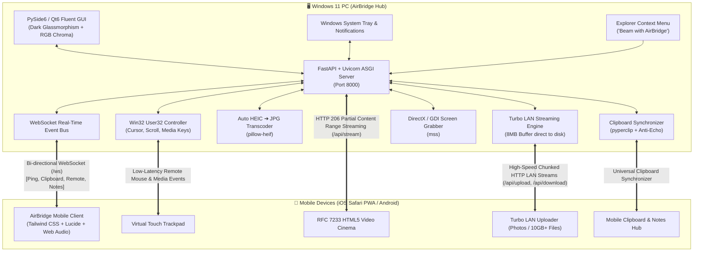

<div align="center">

  

  # ⚡ AirBridge
  ### Next-Generation Cross-Platform Local AirDrop & Universal Clipboard Hub
  **Seamless Peer-to-Peer Bridge between Windows 11, Apple iOS & Android**

  <p align="center">
    <a href="https://github.com/chathunga2007/AirBridge-Cross-Platform-File-Sharing-and-Universal-Clipboard--Windows-iOS-Android-/releases"></a>
    
    
    
    
    <a href="LICENSE"></a>
  </p>

  <p align="center">
    <strong>Architected & Developed with ❤️ by <a href="https://github.com/chathunga2007">Chathunga Bimsara</a></strong>
  </p>

</div>

---

## 📖 Overview

**AirBridge** is a high-performance, zero-cloud, privacy-first local transfer ecosystem that breaks the ecosystem barrier between **Windows 11** and mobile devices (**iPhone Safari PWA & Android Chrome**).

Without installing any third-party app stores on your phone, AirBridge delivers an ultra-smooth, native **Apple AirDrop-like experience** over your local Wi-Fi network:
* **Zero Cloud & Zero Mobile Data**: 100% of transfers run peer-to-peer at high-speed local line rates (50–120+ MB/s).
* **Automatic iPhone Photo Compatibility**: Transcodes iPhone `.HEIC` / `.HEIF` snapshots on-the-fly into universal `.JPG` files.
* **True Universal Clipboard**: Continuous bi-directional synchronization between Windows OS clipboard and mobile devices.
* **Storage-Free LAN Cinema**: Stream 4K/1080p movies and music directly from PC to iPhone with RFC 7233 Range-Request seeking without filling phone storage.
* **Wireless Trackpad & Presentation Remote**: Transform your mobile touchscreen into a wireless mouse, presentation clicker, and media remote for your PC.
* **Native Windows 11 Integration**: Windows Explorer context menu (*"Beam with AirBridge"*), dynamic RGB Chroma lighting, taskbar icon grouping, and background System Tray execution.

---

## 🌟 Key Features

```
┌────────────────────────────────────────────────────────────────────────┐
│                        ⚡ AirBridge Feature Matrix                     │
├────────────────────────────┬───────────────────────────────────────────┤
│ 🚀 Turbo LAN AirDrop       │ 10GB+ Chunked Multi-Stream direct to disk │
│ 📸 Smart HEIC Transcoder   │ On-the-fly iPhone .HEIC ➔ .JPG conversion │
│ 📋 Universal Clipboard     │ Two-way OS clipboard sync with anti-echo │
│ 📸 Display Screenshot Beam │ Sub-50ms Windows primary monitor beaming │
│ 🎬 Storage-Free Cinema     │ RFC 7233 HTTP 206 Range video streaming   │
│ 🖱️ Wireless Trackpad Remote│ Touchpad, mouse clicks, presentation deck │
│ 📂 Explorer Context Menu   │ Right-click files/folders ➔ Instant Beam  │
│ 📦 1-Tap Batch Archiver    │ Package all shared files into single .ZIP │
│ 📶 LAN Wi-Fi Speedometer   │ Measure real throughput & line-rate MB/s │
│ 🔒 100% Local Privacy      │ Zero telemetry, zero cloud, zero trackers │
└────────────────────────────┴───────────────────────────────────────────┘
```

### 1. 📱 Zero-Config QR Pairing & Fleet Radar
- Auto-detects physical Wi-Fi and Ethernet adapters while automatically filtering out WSL, Docker, VMware, and VPN adapters (Tailscale, WireGuard, ZeroTier).
- Live pairing QR code rendered with one-click URL copy and dynamic network adapter switcher.
- Real-time connected devices fleet radar displaying device OS (`iOS`, `Android`, `Windows`, `macOS`), custom device nicknames, LAN IP, and ping latency.

### 2. 🚀 Turbo 10GB+ LAN Multi-Stream File Transfer
- **Mobile ➔ PC:** Upload hundreds of full-res photos, 4K videos, or multi-gigabyte files directly to `~/Downloads/AirBridge/` with live speedometer, progress bars, and ETA calculations.
- **PC ➔ Mobile:** Drag and drop files or entire folders onto the PC window; folders are automatically compressed into `.zip` archives and beamed instantly.
- **Streaming Async Engine:** 8MB chunked streaming writes eliminate RAM bloat even when transferring massive 10GB+ video footage or disk images.

### 3. 📸 Smart Auto HEIC-to-JPG Converter
- Automatically detects Apple iPhone `.HEIC` / `.HEIF` camera captures and converts them on-the-fly to high-compatibility `.JPG` photos using `pillow-heif` and `PIL`.
- Preserves full EXIF orientation, timestamps, and color profiles.
- Can be toggled on/off instantly via the Desktop GUI or Mobile UI.

### 4. 📋 Universal Bi-Directional Clipboard Sync
- **Windows ➔ Mobile:** Any text or link copied on PC (`Ctrl+C`) automatically reflects across all connected phone screens in real-time.
- **Mobile ➔ Windows:** Type or paste notes/links on your phone and tap **"Inject into Windows Clipboard"** to instantly update the Windows OS clipboard and trigger a desktop toast notification.
- Built-in feedback loop suppression prevents bounced clipboard echoes.

### 5. 🎬 Storage-Free LAN Cinema (RFC 7233 Video Streaming)
- Stream massive 1080p and 4K movies (`.mp4`, `.mkv`, `.mov`, `.webm`) directly from your PC storage.
- Full **RFC 7233 HTTP 206 Partial Content Range-Request** streaming allows iPhone Safari's native video player to scrub, seek, buffer, and play without consuming a single megabyte of iPhone storage.
- Includes playback speed adjustment (0.75x, 1x, 1.25x, 1.5x), ±10s seeking, ambient backlight glow, and a built-in Cyber Cinema 60FPS demo stream.

### 6. 🖱️ Wireless PC Trackpad & Presentation Remote
- **Virtual Trackpad:** Smooth cursor control, 1-finger tap (left click), right click, and 2-finger / mouse wheel scrolling with 1.0x, 1.6x, and 2.4x sensitivity controls.
- **Presentation Deck:** Wireless clicker for PowerPoint, Keynote, and PDF slide decks (*Next Slide*, *Previous Slide*, *Advance Space*, *Exit/Esc*).
- **Multimedia Controls:** Volume Up/Down, Mute, Play/Pause, Show Desktop (*Win+D*), and Lock Windows PC (*Win+L*).

### 7. 📸 Instant Desktop Display Screen Beaming
- Capture your primary Windows monitor in sub-50 milliseconds via direct DirectX/GDI hook (`mss`).
- Beams directly to mobile screens with options to view fullscreen, zoom, or save directly to iOS Camera Roll.

### 8. 📂 Windows Explorer Shell Integration ("Beam with AirBridge")
- Right-click any file or folder directly inside Windows File Explorer and select **"Beam with AirBridge"**.
- AirBridge automatically launches (or focuses) and immediately broadcasts the selected item to all connected devices.

### 9. 📦 1-Tap Batch ZIP Archiver
- Download all session files or folder drops in a single compressed `.zip` package from either the Windows GUI or the Mobile PWA client.

### 10. 📶 LAN Wi-Fi Speedometer (Throughput Benchmark)
- Built-in local benchmark utility tests line-rate Wi-Fi upload and download speeds between your phone and PC, proving zero mobile data consumption.

### 11. 🔊 Web Audio API Procedural Sound FX
- 100% zero-asset, synthesized audio chimes generated using browser `AudioContext` oscillators for connection, transfer completion, quick notes, and screen beaming.

---

## 🏗️ Architecture & Communication Flow



---

## 💻 Tech Stack

| Component | Technology | Purpose |
|:---|:---|:---|
| **Desktop GUI** | `PySide6` / `PyQt6` (Qt 6.6+) | Fluent Glassmorphic dark UI, RGB Chroma engine, drag-drop card |
| **Backend API** | `FastAPI` (0.110+) & `Uvicorn` | Asynchronous REST endpoints, RFC 5987 streaming, static file serving |
| **Real-time Bus** | `WebSockets` (12.0+) | Real-time bi-directional fleet coordination & touch translation |
| **Image Processing** | `Pillow` & `pillow-heif` (0.16+) | On-the-fly Apple HEIC/HEIF decoding and EXIF-preserved JPEG encoding |
| **System Automation** | `pyperclip` & `mss` | Native OS clipboard surveillance & sub-50ms screen frame capture |
| **Windows Native** | `pywin32` & `ctypes User32` | Shell shortcuts, AppUserModelID, mouse simulation, media keystrokes |
| **Mobile PWA** | `HTML5`, `Tailwind CSS`, `Lucide` | iOS Safari PWA touch interface with Web Audio synthesizer |
| **Packaging** | `PyInstaller` & `Inno Setup 7` | Standalone executable compilation and Windows setup wizard |

---

## 📂 Repository Structure

```text
AirBridge/
├── assets/
│   ├── AirBridge-Icon.png          # High-resolution original brand emblem
│   ├── AirBridge-Logo.png          # Wide brand banner logo
│   ├── icon.ico                    # Windows multi-resolution icon (16x16 to 256x256)
│   └── icon.png                    # Mobile PWA apple-touch-icon
├── core/
│   ├── __init__.py
│   ├── config.py                   # Central settings, paths, and dataclasses
│   ├── network.py                  # Physical LAN IPv4 resolver & pairing QR generator
│   ├── server.py                   # FastAPI REST API, Range streaming, and WebSockets
│   ├── websocket_manager.py        # Active connection fleet manager & broadcasting
│   ├── heic_converter.py           # pillow-heif auto HEIC-to-JPG conversion engine
│   ├── clipboard_sync.py           # Background clipboard monitor with loop suppression
│   ├── remote_control.py           # Win32 User32 mouse, touchpad, and media keys controller
│   ├── screenshot.py               # Fast monitor grab utility using mss
│   └── shell_integration.py        # Windows Explorer right-click context menu integration
├── gui/
│   ├── __init__.py
│   ├── qt_compat.py                # Seamless PySide6 / PyQt6 interoperability layer
│   ├── main_window.py              # Modern dark glassmorphic dashboard & event handlers
│   └── tray_icon.py                # Windows System Tray icon, menu & balloon toasts
├── mobile_ui/
│   ├── index.html                  # Responsive iOS/Android PWA client interface
│   └── manifest.json               # Web App Manifest for Home Screen standalone installation
├── AirBridge.spec                  # PyInstaller build specification
├── installer_script.iss            # Inno Setup 7 installer wizard script
├── build_installer.bat             # 1-Click build script (PyInstaller + Inno Setup)
├── Start-AirBridge.bat             # Quick launch batch script
├── Launch-AirBridge.vbs            # Silent background launcher (no command prompt)
├── main.py                         # Application main entry point
├── requirements.txt                # Python dependencies
├── LICENSE                         # Official MIT License
└── README.md                       # Comprehensive documentation
```

---

## 🚀 Installation & Usage

### Method 1: Windows Setup Wizard Installer (Recommended)

1. Download **`AirBridge-Setup-v1.0.0.exe`** from the [GitHub Releases](https://github.com/chathunga2007/AirBridge-Cross-Platform-File-Sharing-and-Universal-Clipboard--Windows-iOS-Android-/releases) page.
2. Run the installer and click **Next**:
   - Creates Desktop & Start Menu shortcuts.
   - Registers Windows Explorer right-click context menu (*"Beam with AirBridge"*).
   - Optionally enables startup with Windows.
3. Launch AirBridge and scan the QR code with your iPhone Safari or Android Camera!

---

### Method 2: Run from Python Source

#### Prerequisites
- **Windows 10 / 11**
- **Python 3.11+** installed ([python.org](https://www.python.org/downloads/))
- PC and phone connected to the **same local Wi-Fi network**

#### Steps
```powershell
# 1. Clone the repository
git clone https://github.com/chathunga2007/AirBridge-Cross-Platform-File-Sharing-and-Universal-Clipboard--Windows-iOS-Android-.git
cd AirBridge-Cross-Platform-File-Sharing-and-Universal-Clipboard--Windows-iOS-Android-

# 2. Install dependencies
pip install -r requirements.txt

# 3. Launch AirBridge
python main.py
```

> [!TIP]
> **Silent Background Launch:** You can run `Launch-AirBridge.vbs` or `Start-AirBridge.bat` to launch AirBridge smoothly without leaving an open terminal window.

---

### Method 3: Compile Standalone Executable & Installer from Source

You can re-compile the standalone executable and the setup wizard installer at any time:

```powershell
# Run the automated 1-click build script
.\build_installer.bat
```

Or run the steps manually:
```powershell
# 1. Compile standalone executable with PyInstaller
python -m PyInstaller --clean --noconfirm AirBridge.spec

# 2. Compile setup wizard installer with Inno Setup 6/7
& "C:\Program Files\Inno Setup 7\ISCC.exe" installer_script.iss
```
The resulting installer is saved as **`AirBridge-Setup-v1.0.0.exe`**.

---

## 📱 Pairing with Mobile Devices

1. Open the AirBridge dashboard on your PC.
2. Point your **iPhone Camera** (or Android Camera) at the on-screen QR code and tap the link to open in Safari / Chrome.
3. **iPhone Safari PWA Experience:**
   - Tap Safari's **Share** button (box with upward arrow).
   - Select **Add to Home Screen**.
   - Tap the new **AirBridge icon** on your home screen to launch in full standalone PWA mode (zero URL bars, full screen native feel).
4. You are now paired! Drop files, sync clipboard, stream videos, and use your phone as a trackpad.

---

## 🎮 Mobile Remote Control Cheatsheet

| Action | Mobile Gesture / Control | Windows PC Effect |
|:---|:---|:---|
| **Move Cursor** | Drag 1 finger on touchpad surface | Moves Windows mouse cursor with acceleration |
| **Left Click** | Tap with 1 finger on touchpad surface | Single left mouse click |
| **Right Click** | Tap "Right Click" button | Single right mouse click / context menu |
| **Mouse Wheel Scroll** | Drag 2 fingers vertically on touchpad | Smooth vertical mouse wheel scroll |
| **Slide Presentation** | Tap "Prev Slide" or "Next Slide" | Sends Left / Right arrow keys for slide decks |
| **Advance Slide** | Tap "Advance" | Sends Spacebar key |
| **Exit Slide Show** | Tap "Exit / Esc" | Sends Escape key |
| **Volume Control** | Tap "Vol Up" / "Vol Down" / "Mute" | Multimedia volume adjustment |
| **Play / Pause** | Tap "Play/Pause" | Multimedia play/pause toggle |
| **Show Desktop** | Tap "Show Desktop" | Executes Win + D shortcut |
| **Lock PC** | Tap "Lock Windows PC" | Executes workstation lock (Win + L) |

---

## 🛡️ Security & Privacy

* **Zero Cloud Dependence:** All network traffic stays exclusively within your local Wi-Fi / Ethernet subnet. No data is ever transmitted to external servers.
* **Session Token Authentication:** Dynamic high-entropy pairing tokens protect against unauthorized LAN access.
* **Path-Traversal Protected:** File downloads, streams, and uploads sanitize filenames to prevent path traversal outside the designated storage folder.
* **100% Open Source:** Full visibility into all source code, networking hooks, and system calls.

---

## 💡 Developer Credits

* **Architect & Lead Developer:** **[Chathunga](https://github.com/chathunga2007)**
* **GUI & System Integration:** Qt6 / PySide6, Win32 API, ctypes, pyperclip, mss, qrcode
* **Server & Streaming Engine:** FastAPI, Uvicorn, WebSockets, pillow-heif, python-multipart
* **Mobile Experience:** HTML5, Tailwind CSS, Lucide Icons, Web Audio API

---

## 📄 License

This project is licensed under the **MIT License** - see the [LICENSE](LICENSE) file for complete details.

```text
MIT License
Copyright (c) 2026 Chathunga Bimsara
```

---

<div align="center">
  <strong>⚡ AirBridge • Fast, Elegant, Local AirDrop & Universal Clipboard for Everyone</strong>
</div>