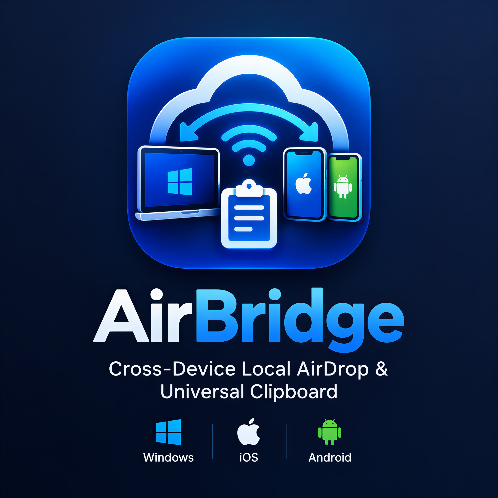

# ⚡ AirBridge
### Next-Generation Cross-Device Local AirDrop & Universal Clipboard Hub for Windows, iOS & Android
**Architected & Developed with ❤️ by Chathunga**

---

AirBridge is a high-performance, zero-cloud, privacy-first local network hub that connects Windows 11 PCs with iPhones (via Safari PWA) and Android devices. It enables instant file drops, automatic iPhone `.HEIC` to `.JPG` conversion, continuous two-way clipboard synchronization, instant desktop screenshot beaming, and storage-free HTTP Range-Request media streaming.



---

## 🌟 Key Features

### 1. 📱 Zero-Config QR Pairing & Live Device Indicators
- Auto-detects the active physical Wi-Fi or Ethernet IPv4 address (filtering out WSL, Docker, and VMware virtual adapters).
- Generates a pairing QR code in the Windows desktop app.
- Scanning with iPhone Safari or Android Camera instantly connects over secure local WebSockets with live ping and peer count indicators.

### 2. 🚀 Bi-Directional High-Speed LAN Transfer
- **Mobile ➔ PC:** Upload multiple full-resolution photos, 4K videos, or files directly from iPhone Camera Roll / Files app into `~/Downloads/AirBridge/` on Windows with live progress bars and MB/s speed metrics.
- **PC ➔ Mobile:** Drag and drop any file directly onto the Windows app dashboard; it automatically notifies connected devices over WebSockets for instant 1-tap downloading.

### 3. 📸 Smart Auto HEIC-to-JPG Converter (iPhone Special)
- Apple devices save photos in high-efficiency `.HEIC`/`.HEIF` format, which Windows cannot preview without third-party codecs.
- AirBridge features an integrated on-the-fly HEIC converter powered by `pillow-heif` and PIL.
- Preserves EXIF orientation and color profiles while converting photos into universal `.JPG` files before saving to PC.
- Can be toggled on/off at any time from the Desktop UI.

### 4. 📋 Two-Way Universal Clipboard
- **PC ➔ Mobile:** Continuous background watcher captures copied text or links on Windows and beams them to connected phones in real time.
- **Mobile ➔ PC:** Type or paste text on the mobile PWA and tap **"Inject into Windows Clipboard"** to immediately update the Windows OS clipboard via `pyperclip` and show a desktop toast notification.
- Features built-in loop suppression to prevent echo feedback between devices.

### 5. ⚡ Instant Screenshot Beam (PC ➔ iPhone)
- Tap **"📸 Beam Screen"** on either PC or mobile.
- Grabs the primary Windows display in ultra-fast memory (<50ms using `mss`/GDI) and pops it up on the iPhone screen with options to view fullscreen or save directly to iOS Photos.

### 6. 🎬 Storage-Free LAN Video/Audio Streaming (RFC 7233)
- Stream massive 1080p/4K movie files (`.mp4`, `.mkv`, `.mov`) or audio without filling up iPhone storage.
- Full HTTP 206 Partial Content Range-Request support allows the native iPhone Safari `<video>` player to scrub, seek, and buffer smoothly without downloading the file.

### 7. 🚀 Turbo 10GB+ Streaming Transfer Engine
- Ultra-optimized 4MB chunked async stream writer (`CHUNK_SIZE = 4*1024*1024`) direct to disk.
- Capable of moving multi-gigabyte (10GB+) ISOs, raw video shoots, and massive zip archives at local line rate without RAM saturation or browser timeouts.
- Real-time speedometer displaying MB/s transfer velocity, transferred byte count, and dynamic ETA calculations.

### 8. 📡 Active Fleet Radar & Device Profiling
- Real-time live connected devices radar: view device platform (iOS / Android / Desktop), custom nicknames, IP addresses, and ping latency.
- Desktop UI features a real-time Connected Fleet sidebar panel; Mobile PWA features a glassmorphism Network Hub modal with customizable device nicknames.

### 9. 📝 Quick Notes & Sticky Links Beam
- Instant note and link transmission across devices with 1-click copy and auto-link opening.
- Synchronized across the entire fleet in sub-10 milliseconds via WebSocket broadcast.

### 10. 🔊 Web Audio API Synthesized Cyber Chimes
- 100% zero-asset, procedural audio cues generated entirely via the browser's Web Audio API (`AudioContext`).
- Distinct harmonic chimes for device connection, upload completion, quick note reception, and screenshot beaming.

---

## 🛠️ System Architecture

```text
AirBridge/
├── assets/
│   ├── AirBridge-Icon.png        # Original High-Res Custom Icon
│   ├── AirBridge-Logo.png        # Branding Banner & Touch Logo
│   ├── icon.ico                  # Multi-resolution Windows Window & Tray Icon
│   └── icon.png                  # PWA Touch & Titlebar Icon
├── core/
│   ├── __init__.py
│   ├── config.py                 # Paths, ports, session tokens, and settings
│   ├── network.py                # Accurate LAN IPv4 detection & QR generation
│   ├── server.py                 # FastAPI app, REST APIs & RFC 7233 video streamer
│   ├── websocket_manager.py      # Real-time WebSocket connection & broadcast bus
│   ├── heic_converter.py         # pillow-heif to JPG conversion logic
│   ├── clipboard_sync.py         # pyperclip watcher & remote injector
│   └── screenshot.py             # High-speed monitor capture utility
├── gui/
│   ├── __init__.py
│   ├── qt_compat.py              # Seamless PySide6 / PyQt6 interoperability layer
│   ├── main_window.py            # Dark Glassmorphism Fluent Desktop UI & Drop Zone
│   └── tray_icon.py              # Windows System Tray Integration
├── mobile_ui/
│   ├── index.html                # iOS Safari PWA interface (Tailwind CSS + JS)
│   └── manifest.json             # Dynamic PWA Manifest for Home Screen install
├── main.py                       # App entry point (Windows AppUserModelID + FastAPI + GUI)
├── requirements.txt              # Production Python dependencies
└── README.md                     # Documentation
```

---

## 🚀 Getting Started

### 1. Prerequisites
- **Python 3.11+** installed on Windows.
- Windows PC and Mobile devices connected to the **same Wi-Fi network**.

### 2. Installation
Open PowerShell in the project directory:

```powershell
pip install -r requirements.txt
```

### 3. Launching AirBridge
Run the application:

```powershell
python main.py
```

1. The Windows Dark Glassmorphism dashboard will appear.
2. The custom AirBridge icon will display in the Windows Taskbar and System Tray.
3. Scan the on-screen QR code with your iPhone Safari or Android Camera.
4. On iOS Safari, tap **Share ➔ Add to Home Screen** for the full native app experience.

---

## 💡 Developer Credits
- **Architect & Lead Developer:** Chathunga
- **Engine:** Python, FastAPI, Uvicorn, PySide6 / PyQt6, pillow-heif, mss, pyperclip.
- **Client:** HTML5, Tailwind CSS, Lucide Icons, WebSocket Event Bus.
